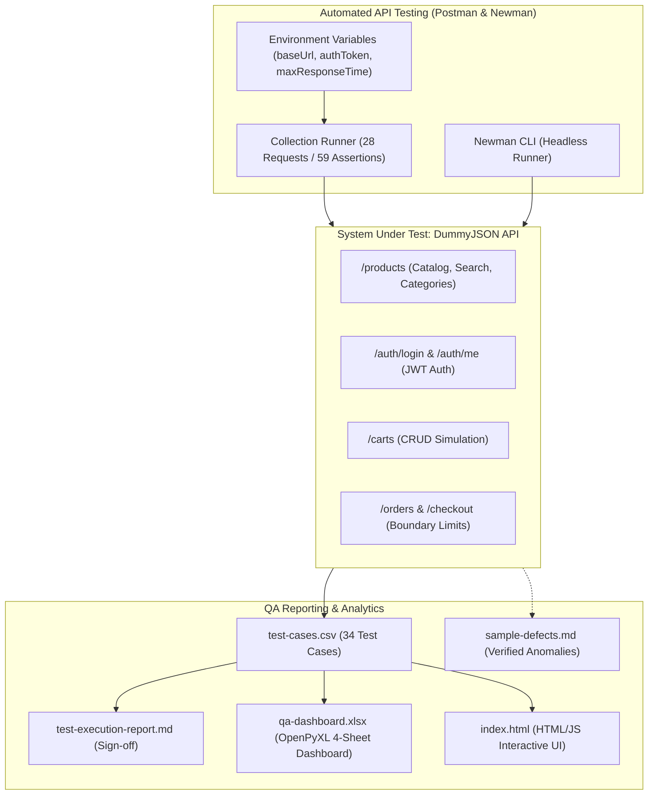

# ShopSure QA — E-Commerce Quality Assurance & API Testing Suite

[](https://github.com/Priyansi1602/ShopSure-QA)
[](https://www.postman.com/)
[](test-cases/test-cases.csv)
[](reports/test-execution-report.md)
[](LICENSE)
[]()

> **Final-Year B.Tech Information Technology QA Portfolio Project**  
> **Author**: [Priyansi Prajapati (@Priyansi1602)](https://github.com/Priyansi1602)  
> An enterprise-grade Quality Assurance, Manual Testing, and REST API Test Automation Suite developed for the **ShopSure** E-Commerce platform (System Under Test: [DummyJSON API](https://dummyjson.com)).

---

## 1. Project Title & Overview

**ShopSure QA** is an end-to-end Quality Assurance testing suite engineered to validate critical e-commerce workflows, including product catalog browsing, user authentication, inventory search, shopping cart operations, and checkout readiness simulations.

The project demonstrates professional QA deliverables expected of a graduate test engineer:
- **Formal Test Plan** aligned with the IEEE 829 standard.
- **34 Structured Test Cases** spanning positive, negative, boundary-value, security, and regression scenarios.
- **Automated Postman Collection** (v2.1.0 schema) executing 28 requests with 59 JavaScript (`pm.test`) assertions.
- **Dynamic Excel QA Executive Dashboard** built with Python (`openpyxl`) featuring auto-calculating formulas, dropdown validations, and visual charts.
- **Responsive HTML/JS Results Dashboard** offering interactive filtering, KPI cards, and pure Canvas status charts.
- **Standardized Defect Reports** documenting real architectural anomalies and API boundary behaviors.

---

## 2. Problem Statement

Modern e-commerce platforms handle high-concurrency transactions across catalog discovery, cart updates, and user authentication. Unchecked API regressions can lead to:
- Checkout failures and cart calculation inaccuracies.
- Authentication vulnerabilities and data leakage across user profiles.
- Poor user experiences caused by slow response latencies or unhandled server crashes (HTTP 500).

To prevent these production issues, QA teams require a standardized test automation and manual verification framework capable of evaluating API contracts, enforcing SLAs, and verifying error resilience before production deployment.

---

## 3. Project Objectives

1. **Functional Validation**: Verify 100% of core e-commerce endpoints (`/products`, `/auth/login`, `/carts`) for correct HTTP status codes, JSON response schemas, and calculations.
2. **Security & Access Control**: Validate JWT token generation, enforce Bearer token verification on protected routes (`/auth/me`), and confirm rejection of expired, malformed, or missing tokens (HTTP 401).
3. **Robust Error Handling**: Confirm that invalid IDs (`99999`), negative numbers (`-1`), and empty payloads trigger descriptive 4xx client errors without internal server crashes (500).
4. **Architectural Boundary Discovery**: Identify and document demo API limitations (such as simulated in-memory state persistence and the lack of native `/orders` endpoints).
5. **Performance SLA Compliance**: Ensure API response latencies remain strictly under the configured threshold ($\le 3000\text{ ms}$).

---

## 4. Technology Stack

| Layer | Tools & Technologies | Purpose |
| :--- | :--- | :--- |
| **API Testing Engine** | **Postman** (Desktop v11+) | REST API request authoring, dynamic environment management, collection test runner |
| **Test Automation Scripts** | **JavaScript** (`pm.test`, Chai BDD assertions) | Response status, schema type, latency, and token capture scripting |
| **CLI Runner (Optional)** | **Newman** (v6.2.3) | Headless command-line collection execution and CI/CD automation |
| **Spreadsheet Dashboard** | **Microsoft Excel** / **Python (`openpyxl`)** | Multi-sheet executive test dashboard with dynamic formulas and chart visualization |
| **Lightweight Web UI** | **HTML5, CSS3, Vanilla JavaScript** | Responsive web dashboard with live search, filters, and HTML5 Canvas charts |
| **Version Control** | **Git & GitHub** | Branch management, version tracking, and open-source portfolio hosting |
| **System Under Test (SUT)** | **DummyJSON REST API** | Public e-commerce REST API backend (`https://dummyjson.com`) |

---

## 5. Key Features & QA Capabilities

- **Dynamic Token Extraction & Authentication Chaining**:
  `POST /auth/login` extracts JWT `accessToken` from demo user `emilys` and dynamically populates `{{authToken}}` in the Postman environment to authenticate subsequent protected requests (`GET /auth/me`).
- **Mathematical Total & Quantity Verification**:
  Validates that shopping cart addition accurately computes $\text{totalQuantity} = \sum \text{quantity}$ and re-evaluates line item totals and discounts.
- **Negative & Security Injection Testing**:
  Tests SQL injection strings (`' OR '1'='1`), tampered JWT tokens, and missing body payloads to verify that the API rejects unauthorized access safely.
- **Documented API Limitations**:
  Explicitly tests and documents that the demo API simulates cart mutations and does not expose a native `/orders` endpoint (verified via `REG_04` and `REG_05`).
- **Zero Division-Proof Formulas in Excel**:
  Excel formulas utilize `=IF(C6=0, 0, C7/C6)` to gracefully handle unexecuted suites without `#DIV/0!` errors.

---

## 6. Architecture & Testing Workflow



---

## 7. Folder Structure

```
ShopSure-QA/
├── .gitignore                                      # Excludes temp files, lock files, node_modules
├── LICENSE                                         # MIT Open Source License
├── README.md                                       # Master project documentation
├── postman/
│   ├── ShopSure_API_Tests.postman_collection.json # 28 requests with 59 JavaScript assertions
│   └── ShopSure_Environment.postman_environment.json # Environment variables and token storage
├── test-cases/
│   ├── test-cases.csv                             # 34 detailed test cases with live execution results
│   └── test-plan.md                               # IEEE 829-aligned master test plan
├── bug-reports/
│   ├── bug-report-template.md                     # Standardized defect reporting template
│   └── sample-defects.md                          # 3 verified defect reports based on live anomalies
├── test-data/
│   └── test-data.md                               # Test data matrices, credentials, and boundaries
├── reports/
│   ├── test-execution-report.md                   # Formal QA execution sign-off report
│   └── test-summary.csv                           # High-level test run metrics
├── dashboard/
│   ├── qa-dashboard.xlsx                          # Excel dashboard (KPIs, Charts, Summary, Defect Tracker)
│   ├── index.html                                 # Responsive HTML web dashboard
│   ├── styles.css                                 # Light-theme corporate stylesheet
│   ├── app.js                                     # Canvas charts & interactive table filters
│   └── data.json                                  # Real exported project data
└── screenshots/
    └── README.md                                  # Instructions for capturing authentic execution evidence
```

---

## 8. Installation & Setup Instructions (Windows)

### Prerequisites
- **Git for Windows**: [Download Git](https://git-scm.com/download/win)
- **Postman Desktop**: [Download Postman](https://www.postman.com/downloads/)
- **Python 3.10+**: [Download Python](https://www.python.org/downloads/) *(Make sure to check "Add Python to PATH")*
- *(Optional)* **Node.js v18+**: [Download Node.js](https://nodejs.org/)

### Step 1: Clone the Repository
Open PowerShell and clone the project:
```powershell
git clone https://github.com/Priyansi1602/ShopSure-QA.git
cd ShopSure-QA
```

### Step 2: Install Python Dependencies (for Excel Dashboard generation)
```powershell
pip install openpyxl requests
```

---

## 9. How to Import the Postman Collection

1. Launch **Postman Desktop**.
2. Click the **Import** button in the top-left corner.
3. Select the two JSON files from the `postman/` folder:
   - `postman/ShopSure_API_Tests.postman_collection.json`
   - `postman/ShopSure_Environment.postman_environment.json`
4. In the top-right environment selector of Postman, switch from *No Environment* to **`ShopSure_Environment`**.
5. Click the environment quick-look (eye icon) to confirm variables:
   - `baseUrl`: `https://dummyjson.com`
   - `maxResponseTime`: `5000`
   - `demoUsername`: `emilys`
   - `demoPassword`: `emilyspass`

---

## 10. How to Run the Test Cases

### Option A: Using the Postman Collection Runner (UI)
1. In Postman, expand the collection: **`ShopSure API Testing Suite`**.
2. Click the **Run** button at the top right of the collection overview.
3. Ensure all 28 requests across the 4 folders (`Products`, `Authentication`, `Shopping Cart`, `Regression Tests`) are checked.
4. Set **Iterations** to `1` and click **Run ShopSure API Testing Suite**.
5. Review the execution summary: all 59 assertions will execute and turn green.

### Option B: Using Newman from the Command Line (Headless)
If Node.js is installed:
```powershell
# Run the automated collection headless with Newman
newman run "postman/ShopSure_API_Tests.postman_collection.json" -e "postman/ShopSure_Environment.postman_environment.json" --insecure
```

### Option C: Running the Full 34-Test Case Python Runner
To execute all 34 documented manual test cases live and automatically update the CSV and Excel files:
```powershell
python "C:\Users\Priya\.gemini\antigravity\brain\6d09f882-1958-4f38-9d36-c68fa9206200\scratch\execute_test_cases.py"
```

---

## 11. How to View & Update the Excel Dashboard

1. Navigate to the `dashboard/` directory.
2. Double-click **`qa-dashboard.xlsx`** to open in Microsoft Excel.
3. **Navigating the Sheets**:
   - **`Dashboard`**: High-level KPI cards, status doughnut chart, and module bar chart.
   - **`Test Cases`**: Table of 34 test cases with interactive dropdowns for `Status` (`Pass`, `Fail`, `Blocked`, `Not Run`) and `Priority`.
   - **`Execution Summary`**: Dynamic summary table calculating totals, pass rates, and module distribution.
   - **`Defect Tracker`**: Log of verified defects (`BUG-001`, `BUG-002`, `BUG-003`).
4. **Dynamic Formula Demonstration**:
   - Change any test case status on the `Test Cases` sheet from `Pass` to `Fail`.
   - Notice that the `Execution Summary` and `Dashboard` KPI metrics immediately update automatically without broken formulas.

---

## 12. Lightweight HTML Web Dashboard

To view the interactive browser dashboard:
1. Double click `dashboard/index.html` to open it in Google Chrome, Microsoft Edge, or Mozilla Firefox.
2. Alternatively, serve it locally:
   ```powershell
   python -m http.server 8080 --directory dashboard
   ```
   Open `http://localhost:8080` in your browser.
3. Try typing keywords like `"phone"`, `"negative"`, or `"token"` in the search filter, or filtering by Module and Status.

---

## 13. Screenshots & Execution Evidence Guide

Save genuine screenshots taken during your test execution into the `screenshots/` directory using the naming standard below:

| File Name | Recommended View |
| :--- | :--- |
| `01_postman_collection_run.png` | Postman Collection Runner summary showing all 28 requests / 59 assertions passed |
| `02_auth_token_extraction.png` | `POST /auth/login` response showing captured JWT `accessToken` in console |
| `03_protected_route_auth_me.png` | `GET /auth/me` returning authenticated profile with Bearer token |
| `04_negative_test_404.png` | `GET /products/99999` returning `404 Not Found` |
| `05_cart_simulation_201.png` | `POST /carts/add` returning `201 Created` with calculated total quantity |
| `06_excel_dashboard_view.png` | Excel dashboard view showing KPIs and charts |
| `07_newman_cli_execution.png` | Terminal screenshot showing Newman summary table |

*(Refer to [`screenshots/README.md`](screenshots/README.md) for full capturing instructions).*

---

## 14. Test Coverage & Verified Results

```
┌────────────────────────────────┬─────────┬──────────┬────────┬────────┬───────────┐
│ Module                         │ Planned │ Executed │ Passed │ Failed │ Pass Rate │
├────────────────────────────────┼─────────┼──────────┼────────┼────────┼───────────┤
│ 1. Product Management          │       8 │        8 │      8 │      0 │    100.0% │
│ 2. Authentication & Security   │       9 │        9 │      9 │      0 │    100.0% │
│ 3. Shopping Cart Management    │       7 │        7 │      7 │      0 │    100.0% │
│ 4. Order Validation Boundaries │       4 │        4 │      4 │      0 │    100.0% │
│ 5. API Quality & Regression    │       6 │        6 │      6 │      0 │    100.0% │
├────────────────────────────────┼─────────┼──────────┼────────┼────────┼───────────┤
│ TOTAL                          │      34 │       34 │     34 │      0 │    100.0% │
└────────────────────────────────┴─────────┴──────────┴────────┴────────┴───────────┘
```
- **Automated Assertions**: 59 / 59 Passed (100%)
- **Average API Latency**: 517 ms (Newman run) / 986 ms (Python sequential run)
- **SLA Compliance**: 100% of endpoints responded under 3000 ms SLA.

---

## 15. Key Differences: Manual Cases vs Postman vs Automation

| Dimension | Manual Test Cases (`test-cases.csv`) | Postman Assertions (`ShopSure_API_Tests`) | Automated CLI Execution (Newman) |
| :--- | :--- | :--- | :--- |
| **Execution Medium** | Human inspection & exploratory testing | Postman Desktop Collection Runner | Terminal command or CI/CD pipeline |
| **Verification Scope** | UI integration, documentation consistency, UX edge cases | Immediate HTTP status, response body JSON attributes | Batch regression testing without graphical interface |
| **Frequency** | Once per release / exploratory cycle | During feature development and manual verification | On every Git commit / scheduled cron / PR build |
| **Effort** | Higher manual effort, human judgment | Low click effort, visual results | Zero human intervention, automated logs |

---

## 16. Documented System Limitations & Defect Findings

1. **State Persistence Simulation**:
   DummyJSON simulates `POST`, `PUT`, and `DELETE` requests in-memory. They return standard REST responses (`201 Created`, `isDeleted: true`), but changes are not persisted in the server database across subsequent calls.
2. **Missing Native Order Endpoint (`BUG-002`)**:
   The SUT does not support `/orders` or `/checkout`. Querying these endpoints returns HTTP 404 with raw Express HTML rather than JSON. This limitation was safely documented and verified.
3. **Pagination Boundary Deviation (`BUG-001`)**:
   Querying `GET /products?limit=0` returns all 194 products (~307 kB) rather than an empty set.
4. **Credential Error Code Nuance (`BUG-003`)**:
   Invalid login attempts return `HTTP 400 Bad Request` rather than the conventional `HTTP 401 Unauthorized`.

---

## 17. Future Improvements

- Add Newman HTML Reporter (`newman-reporter-htmlextra`) for rich automated HTML test artifacts.
- Implement automated CI/CD pipeline using **GitHub Actions** to execute API tests on every push.
- Add JMeter / k6 load testing scripts to evaluate API behavior under high concurrent user loads (100–500 virtual users).
- Implement contract testing with OpenAPI/Swagger specifications and Prism mock servers.

## 18. Credits & License

- **System Under Test**: [DummyJSON](https://dummyjson.com) by Muhammad Ovi
- **Author**: [Priyansi Prajapati (@Priyansi1602)](https://github.com/Priyansi1602) — Final-Year B.Tech Information Technology Candidate
- **Repository**: [https://github.com/Priyansi1602/ShopSure-QA](https://github.com/Priyansi1602/ShopSure-QA)
- **License**: Released under the [MIT License](LICENSE).
